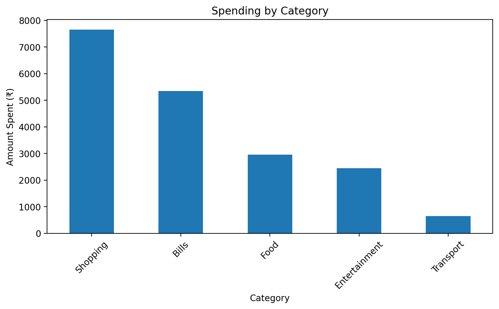
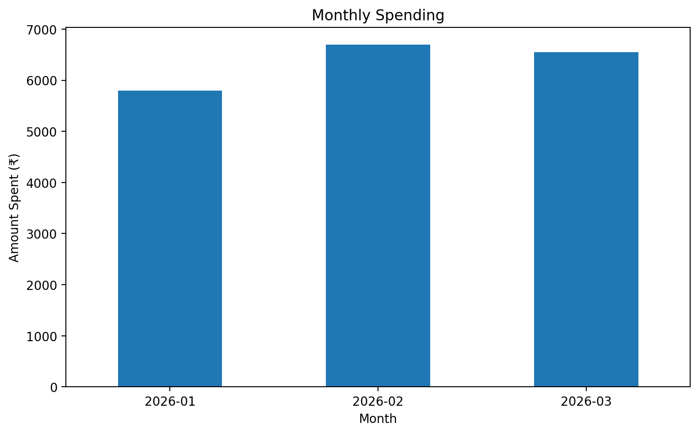
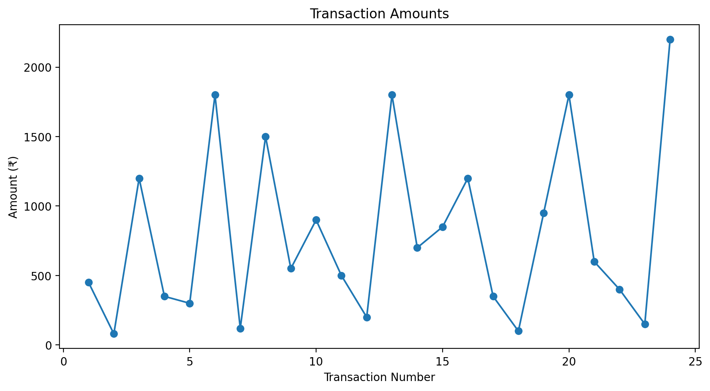

# Personal Finance & Spending Analyzer

## Project Overview

This project analyzes personal spending patterns using Python, Pandas, and Matplotlib.

The project explores transaction data to identify spending patterns, high-expense categories, monthly spending trends, and individual high-value transactions.

It also demonstrates a basic data-cleaning workflow by identifying missing values and duplicate records and then producing a cleaned dataset.

## Objectives

- Analyze personal spending patterns
- Calculate total and average spending
- Identify the highest spending categories
- Compare monthly spending
- Identify high-value transactions
- Detect missing values and duplicate records
- Clean and prepare transaction data
- Create visualizations to communicate financial patterns
- Generate insights from the analyzed data

## Technologies Used

- Python
- Pandas
- Matplotlib
- Git
- GitHub

## Dataset

The dataset contains **24 financial transactions** across three months.

Each transaction contains:

- Date
- Category
- Description
- Amount
- Transaction Type

The spending categories include:

- Shopping
- Bills
- Food
- Entertainment
- Transport

## Data Analysis

The project calculates:

- Total spending
- Average transaction value
- Highest transaction
- Lowest transaction
- Category-wise spending
- Monthly spending
- Top 5 transactions
- High-spending transactions

## Data Cleaning

To demonstrate a realistic data-analysis workflow, data-quality issues were intentionally introduced into the dataset.

The project introduced:

- One missing transaction amount
- One duplicate transaction

The cleaning process then:

1. Checked for missing values
2. Checked for duplicate records
3. Filled the missing amount using the median transaction amount
4. Removed the duplicate record
5. Rechecked the dataset for remaining issues
6. Exported the cleaned dataset as `transactions_cleaned.csv`

After cleaning, the dataset contained **24 unique transactions with no missing values**.

## Visualizations

The project generates three visualizations:

### 1. Spending by Category

Shows how total spending is distributed across different expense categories.



### 2. Monthly Spending

Shows total spending for January, February, and March 2026.



### 3. Transaction Trend

Shows the amount of each individual transaction across the dataset.



## Key Findings

### Overall Spending

- **Total spending:** ₹19,050
- **Average transaction:** ₹793.75
- **Highest single transaction:** ₹2,200
- **Lowest transaction:** ₹80

### Spending by Category

| Category | Spending |
|---|---:|
| Shopping | ₹7,650 |
| Bills | ₹5,350 |
| Food | ₹2,950 |
| Entertainment | ₹2,450 |
| Transport | ₹650 |

**Shopping** was the largest spending category, accounting for ₹7,650 of the total spending.

### Monthly Spending

| Month | Spending |
|---|---:|
| January 2026 | ₹5,800 |
| February 2026 | ₹6,700 |
| March 2026 | ₹6,550 |

February had the highest monthly spending at **₹6,700**.

### Top 5 Transactions

The five largest transactions were:

- ₹2,200 — Clothes
- ₹1,800 — Electricity
- ₹1,800 — Electricity
- ₹1,800 — Accessories
- ₹1,500 — Shoes

## Data Cleaning Result

Before cleaning:

- **1 missing amount**
- **1 duplicate record**

After cleaning:

- **0 missing values**
- **0 duplicate records**
- **24 unique transactions**

The cleaned dataset was exported as:

`transactions_cleaned.csv`

## Project Structure

```text
personal-finance-analyzer/
│
├── analysis.py
├── transactions_cleaned.csv
├── spending_by_category.png
├── monthly_spending.png
├── transaction_trend.png
└── README.md
```

## Key Skills Demonstrated

- Python programming
- Pandas data manipulation
- Data cleaning
- Missing-value handling
- Duplicate detection
- GroupBy analysis
- Date and time manipulation
- Statistical summaries
- Data visualization
- CSV file handling
- Analytical interpretation

## Conclusion

This project demonstrates a complete introductory data-analysis workflow using Python.

The analysis identified **Shopping** as the largest spending category and **February 2026** as the month with the highest spending. The project also demonstrated how missing values and duplicate records can affect financial datasets and how these issues can be handled systematically.

The project provides a foundation for more advanced financial analytics, including budgeting systems, spending prediction, anomaly detection, and interactive dashboards.
